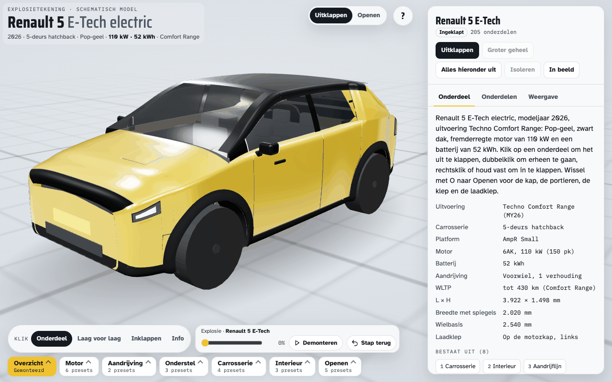

# Renault 5 E-Tech explosietekening

Interactieve 3D-explosietekening van een Renault 5 E-Tech electric, modeljaar 2026/2027 (vernieuwd augustus 2026), uitvoering Techno Comfort Range: Pop-geel met zwart dak, motor 6AK en een batterij van 52 kWh. De pagina staat op het framework van [laguna3](https://github.com/rvd-gmpplus/laguna3). De geometrie is in code opgebouwd; er zijn geen 3D-bestanden.



## Stand

Een herbouw in golven loopt (golf 0 tot en met 5). Golf 0 maakte de docs waar, golf 1 zette de poorten op externe maten en golf 2 (nog niet gepubliceerd) bouwde de carrosserie opnieuw op een geloft vlak. `tools/maat.py` meet nu 3.929 mm lang, 1.774 mm breed, 1.498 mm hoog, wielbasis 2.540 mm, spoor 1.548 en 1.532 mm en 2.016 mm over de spiegels (Renault: 3.922, 1.774, 1.498, 2.540, 1.548, 1.532 en 2.020 mm). Versie 1 had vlakke panelen, 3,821 m lengte, 1,418 m hoogte en een spoor van 1,28 m; zie [docs/onderzoek/stand-v1.md](docs/onderzoek/stand-v1.md).

## De auto

Alle getallen met bron staan in [docs/specificaties-en-bronnen.md](docs/specificaties-en-bronnen.md). Kort:

- Motor 6AK: synchroonmotor met gewikkelde rotor (extern bekrachtigd, zonder zeldzame aardmetalen), 110 kW piek, 245 Nm.
- Batterij: 52 kWh netto, 55 kWh bruto, 400 V, 4 modules, 184 pouchcellen.
- Laden: boordlader 11 kW AC, bidirectioneel (V2L 3,7 kW), DC 100 kW. De laadklep (AC en CCS) zit in het linker voorscherm. Op de motorkap zit een verlichte '5' die de laadstand toont in stappen van 20 %.
- WLTP tot 430 km sinds de update van 25 augustus 2026 (daarvoor 410 km).
- Maten: lengte 3.922 mm, breedte 1.774 mm tussen de spatborden (zonder spiegels 1.808 mm; over het verschil zie de bronlijst), hoogte 1.498 mm, wielbasis 2.540 mm, spoor 1.548 mm voor en 1.532 mm achter.
- Onderstel: pseudo-McPherson voor, multilink achter. Schijfremmen rondom: 296 mm geventileerd voor, 280 mm achter. Banden 195/55 R18.
- Koplampen: smal, met een pupilvorm. De twee afgeronde vierkanten zitten in de bumper.

Het model van versie 1 wijkt hier nog op een paar punten van af (laadklep op de kap, trommels en torsieas achter). Dat herstelt de herbouw; zie [docs/contract.md](docs/contract.md).

## Openen

Open `index.html` in een moderne browser, of de live versie op https://rvd-gmpplus.github.io/r5/. Het bestand laadt three.js r147 van jsDelivr en lettertypes van Google Fonts. Verder is alles ingebouwd. Het werkt op desktop en telefoon, in licht en donker thema (het thema volgt het systeem).

Klik op een onderdeel om de eigen groep uit te klappen. Dubbelklik duikt erheen. Rechtsklik, Shift+klik of vasthouden klapt in. De toets O wisselt naar Openen: motorkap, laadklep, vier portieren, zijruiten, spiegels en achterklep. Presets staan onder de tekening. `?` legt de bediening uit.

De adresbalk is een deelbare link: `?preset=battery` opent de tractiebatterij, `?open=Motorkap` opent de kap.

## Wat erin zit

Acht hoofdgroepen, in de volgorde van het framework: Carrosserie, Interieur, Aandrijflijn, Onderstel, Koeling en luchtinlaat, Uitlaatsysteem, Brandstofsysteem, Elektrisch systeem. Deze auto heeft geen uitlaat en geen brandstoftank. Uitlaatsysteem bevat de platen van de onderbodem. Brandstofsysteem is het laadpad: laadaansluiting, boordlader en de kabel naar de batterij. Elektrisch systeem is de vloeraccu, het BMS, de DC-DC-omzetter en de 12V-accu.

Beeldmerken zijn niet nagetekend: geen ruit en geen letters RENAULT. Eén bewuste uitzondering (besluit van de eigenaar): de verlichte '5' op de motorkap wordt getekend als lamp, omdat hij de laadstand toont. Referentiefoto's van Wikimedia Commons met CC BY-SA 4.0 mogen in `docs/onderzoek/beelden/`, met naamsvermelding in [docs/onderzoek/bronnen.md](docs/onderzoek/bronnen.md). Het beeld uit de Renault-brochure komt niet in de repo, alleen de URL en de gemeten getallen.

## Bouwen

```bash
bash tools/setup.sh
python3 build.py --lint
python3 build.py
```

`index.html` hoort bij `src/` en wordt gecommit. Nederlands is de taal van de teksten. Geen gedachtestreep. `spec` alleen voor feiten die met bron in [docs/specificaties-en-bronnen.md](docs/specificaties-en-bronnen.md) staan. Het chassisnummer en het kenteken van de gebruiker komen niet in deze repo.

## Tests

Groen na golf 2: `python3 build.py --lint`, `python3 tools/framework.py check`, `python3 tools/smoke.py`, `python3 tools/integrity.py` (0 fouten), `python3 tools/tri.py --gate`, `python3 tools/pncheck.py`, `python3 tools/silhouette.py` (silhouet uit de maattekening van de brochure, genormaliseerd op de opgegeven maten, tolerantie 30 mm), de maatpoort `python3 tools/maat.py`, `python3 tools/opentest.py --strikt-min` en `python3 tools/ui_inner.py --open --strict`. De rode set van versie 1 is daarmee groen.

Nightly is rood en blijft rood tot `tools/itest.py` en `docs/baseline/` bestaan: de eerste stap faalt omdat `tools/itest.py` ontbreekt. `python3 tools/pubsmoke.py` meldt `nummergegevens in #pn onleesbaar of leeg (0)` zolang `data/pn/` leeg is. Zie de sectie Bekende ruis in [CLAUDE.md](CLAUDE.md).

## Verder lezen

- [CHANGELOG.md](CHANGELOG.md)
- [docs/contract.md](docs/contract.md)
- [docs/specificaties-en-bronnen.md](docs/specificaties-en-bronnen.md)
- [docs/onderzoek/stand-v1.md](docs/onderzoek/stand-v1.md)
- [docs/framework.md](docs/framework.md)
